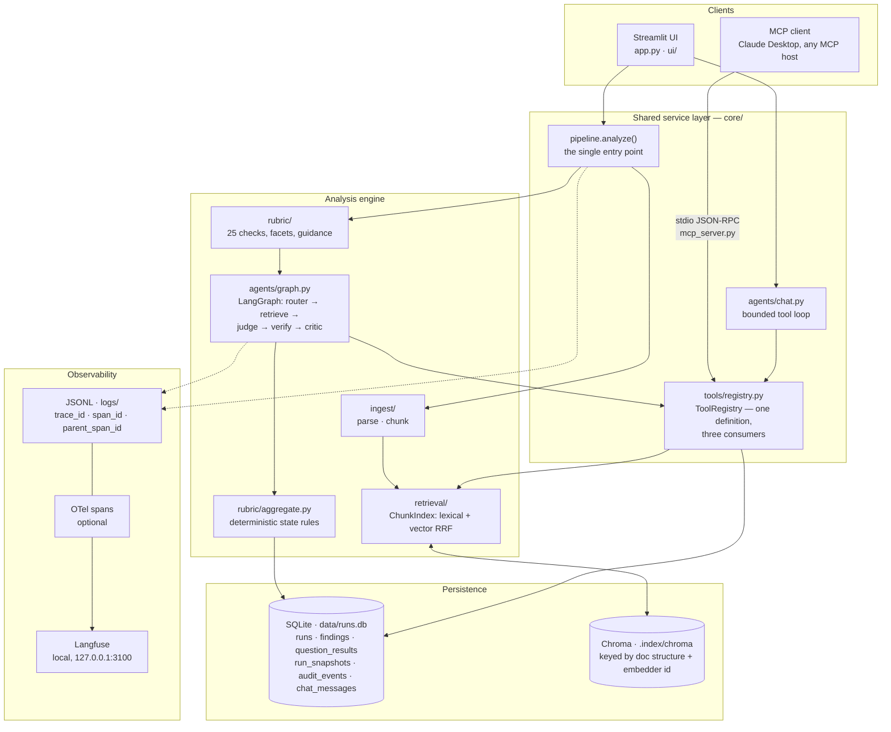
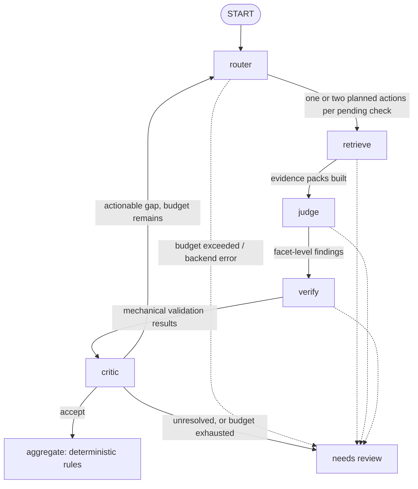

# Contract Analyzer

Upload a contract PDF, answer five fixed compliance questions against it with an agentic RAG
pipeline, and return validated JSON with verbatim, source-referenced quotations — alongside a KPI
dashboard, a structured execution audit, and an MCP tool surface over the same service layer.

Streamlit UI (`app.py`, `ui/`) over an importable core package (`core/`). One LangGraph state
machine per question (`core/agents/graph.py::analyze_question`). SQLite for run history, evidence
snapshots and audit (`core/store/`). Local model inference by default behind an OpenAI-compatible
transport (`core/providers/openai_compat.py`). `mcp_server.py` imports the same `core/tools`
registry the UI and chat use, which is what keeps the MCP deliverable executable rather than
diagrammatic.

**Confidentiality.** The assignment, the sample contract, derived fixtures, indexes, logs and
databases stay local. Do not publish them or send them to hosted inference, embedding or
evaluation services. Remote inference and remote embeddings both require an explicit per-upload
authorization (`allow_remote`) and are refused by default — see [Privacy gate](#privacy-gate).

---

## Assignment coverage

Every requirement, where it is implemented, and what it does not do. Section numbers refer to
`Contract_Analyzer_Assignment_new.pdf`.

| § | Requirement | Where | Boundary |
|---|---|---|---|
| 2.1 | PDF upload via web UI | `app.py::_render_sidebar`, `_analyze_uploaded_file` | Local Streamlit, single operator |
| 2.2 / 3.1 | Parse text, tables, images | `core/ingest/parse.py`, `core/ingest/chunk.py` | Text-extractable PDFs; no OCR, no image interpretation |
| 2.3 / 3.2 | Agentic RAG with routing + evaluation | `core/agents/graph.py` (LangGraph), `core/retrieval/`, `core/tools/` | See [Agent graph](#agent-graph) |
| 2.4 / 7 | Structured validated JSON | `core/output.py`, `core/openapi_schema.py` | Unresolved questions surface separately, not as a fourth state |
| 2.5 / 3.4 | KPI dashboard, real-time + historical | `ui/kpi_view.py`, `core/kpi.py`, `ui/monitoring_view.py`, `core/monitoring.py` | Gold-label metrics unavailable without a reviewed gold set |
| 2.6 / 3.3 | Connector / MCP extensibility | `mcp_server.py`, `core/tools/contract_tools.py`, `openapi.yaml`, `docs/connector-design.md` | MCP is executable; REST is a specification, not a running server |
| 3.5 | Production monitoring | `core/monitoring.py`, `core/obs/otel.py`, local Langfuse | Single-node; no hosted APM |
| 3.6 | Structured logs with trace/span IDs | `core/obs/logging.py`, `core/obs/trace.py` | JSONL + OTel; not a tamper-proof archive |
| 4 | Documented model, version, hosting, cost | [Models and cost](#models-hosting-and-cost-4-10), `core/pricing.py` | Prices are a table, not invoices |
| 5.6 | Slide deck | Prepared separately | Outside the code |
| 5.7 | README + design docs | This file, `docs/design.md`, `docs/architecture.md`, `docs/setup.md`, `docs/limitations.md` | — |
| 6 / 7 | Five questions, three states, confidence, quotes, rationale | `core/rubric/questions.yaml`, `core/output.py::to_compliance_json` | Confidence is a documented heuristic, not calibrated |
| 8 | Bonus: conversational chat | `core/agents/chat.py`, `ui/chat_view.py` | Same tool registry as the graph and MCP |

**Open items before this is complete:** see [Known gaps](#known-gaps). They are specified for
implementation in [`docs/tasks/13-review-fixes.md`](docs/tasks/13-review-fixes.md).

---

## Architecture

Two clients, one service layer, one tool registry. The `core/` boundary is load-bearing: the
Streamlit UI, the chat agent and the MCP server all import the same functions, so the MCP
deliverable is the real system rather than a parallel demo of it. No business logic lives in a
Streamlit callback — anything computable is computed in `core/` and tested without a browser.
(The REST connector in `openapi.yaml` is a specification only and is deliberately absent from
this diagram — see [Connector and MCP](#connector-and-mcp-33).)



### Layers

| Layer | Responsibility | Why the boundary exists |
|---|---|---|
| Clients | Upload, render, converse, expose tools | Swappable. Replacing Streamlit with React changes nothing below it |
| Service (`core/pipeline.py`, `core/tools/`) | One `analyze()`, one `ToolRegistry` | A tool defined once cannot behave differently in chat than in MCP than in the graph |
| Engine (`core/ingest`, `retrieval`, `rubric`, `agents`) | Parse, index, decide | The rubric is data (`questions.yaml`), not code, so the checks can change without touching orchestration |
| Persistence (`core/store/`) | History, evidence snapshots, audit | Historical runs render without the original PDF, which is required once the temp upload is gone |
| Observability (`core/obs/`) | Correlated structured traces | One span tree feeds terminal, file, and Langfuse; no duplicate instrumentation paths |

### Processes at runtime

| Process | Started by | Talks to | Holds |
|---|---|---|---|
| Streamlit app | `./setup.sh` | Local model server, SQLite, Chroma | Session state, one `RunStore`, one analysis worker thread |
| Analysis worker | `app.py` `ThreadPoolExecutor(max_workers=1)` | Model transport | The run; reports `WaitUpdate` progress back over a `Queue` |
| MCP server | `python mcp_server.py` (stdio) | Same `core/`, its own `RunStore` connection | Async job table, latest index |
| Model server | Operator (Ollama / LM Studio) | — | Weights |
| Langfuse stack | `./setup.sh --langfuse` (Docker) | OTLP from the app | Traces, loopback only |

SQLite connections are thread-local (`RunStore._connections`) with WAL enabled, so the MCP worker
thread writes while readers continue.

### One request, end to end

```mermaid
sequenceDiagram
    participant U as User
    participant A as app.py
    participant P as pipeline.analyze
    participant G as graph.analyze_question
    participant R as ToolRegistry
    participant S as RunStore

    U->>A: upload PDF + Analyze
    A->>P: analyze(path, client, allow_remote=False)
    Note over P: span("analyze") opens the trace;<br/>every child inherits trace_id
    P->>P: parse_pdf → chunk_blocks → ChunkIndex
    loop 5 questions
        P->>G: analyze_question(question, index, client)
        loop ≤ 3 rounds, within budget
            G->>R: search_evidence / read_context / resolve_reference / find_modifiers
            R-->>G: chunks with chunk_ids
            G->>G: judge → verify (mechanical) → critic (semantic)
        end
        G-->>P: findings + audit events
        P->>P: aggregate() — deterministic state
    end
    P-->>A: AnalysisResult
    A->>S: save_run() — results, evidence snapshot, ordered audit
    A-->>U: five-field JSON, citations, KPI refresh
```

The trace opens once in `analyze` and every node, tool call and model call nests under it, which
is what makes requirement §3.6 satisfiable: one `trace_id` reconstructs parsing, routing,
judgment and evaluation for any given request.

### Trust boundaries

- **Contract text is data, never instructions.** Every agent prompt states it; the judge and
  critic treat retrieved content as untrusted evidence.
- **Nothing leaves the machine by default.** Inference and embeddings are both gated on an
  explicit per-document `allow_remote`; Langfuse endpoints must be loopback; LangSmith is disabled
  for graph evidence.
- **stdout belongs to JSON-RPC.** Logs go to stderr and file only, so an MCP session cannot be
  corrupted by a log line.

`docs/architecture.md` holds the component-level companion diagram; this section is the system and
process view.

---

## Run locally

Python 3.12 and a local Ollama or LM Studio server.

```bash
./setup.sh                 # create .venv, install, copy .env.example -> .env, start Streamlit
./setup.sh --install-only  # install only
./setup.sh --langfuse      # start the local Langfuse observability stack (Docker)
```

`setup.sh` never overwrites an existing `.env`. To start the UI by hand:

```bash
./.venv/bin/streamlit run app.py --server.address 127.0.0.1
```

Defaults are Ollama `qwen2.5:14b-instruct` for inference and `nomic-embed-text` for embeddings.
`.env` is read once at import (`core/providers/config.py`, `load_dotenv()` with `override=False`),
so exported shell variables always win. The sidebar shows the configured backend and model, and
whether the last call succeeded.

```bash
./.venv/bin/python -m pytest -q                       # full offline suite
./.venv/bin/python -m eval.live_e2e --output-dir PATH # real provider, non-confidential fixtures
echo '{"jsonrpc":"2.0","id":1,"method":"tools/list"}' | ./.venv/bin/python mcp_server.py
```

---

## Pipeline

```text
PDF ─► parse_pdf ─► chunk_blocks ─► ChunkIndex ─► analyze_question × 5 ─► aggregate ─► to_output_document
       layout        structural      lexical +     LangGraph loop        deterministic   assignment JSON
       blocks        chunks          vector        per question          rules           + audit + KPIs
                                                          │
                                                          ▼
                                            SQLite: runs, findings, evidence
                                            snapshots, ordered audit events
```

`core/pipeline.py::analyze` is the single entry point shared by the UI, the chat tools and the MCP
server. It parses, indexes, runs the graph once per question, aggregates deterministically, and
returns an `AnalysisResult` carrying questions, findings, per-stage timings, token/cost usage, the
evidence snapshot and the audit event list.

### Ingestion (§3.1)

`core/ingest/parse.py` uses `pdfplumber` layout coordinates rather than flat text extraction,
because **tables carry answers that prose does not** — one of the five questions in the sample
fixture is answerable only from an exhibit table, and flattening a table to a line of text
destroys the row semantics a citation depends on.

- **Ruled tables** are found geometrically (`vertical_strategy: lines`). Every row becomes a
  `SourceBlock` with its own `cells`, `headers`, page and bounding box.
- **Borderless tables** are admitted conservatively: a candidate needs ≥ 3 rows, ≥ 2 populated
  header cells, and ≥ 2 recognised header keywords, or it is treated as prose.
- **Prose** is assembled from words not inside a table bbox, grouped into lines (3 pt tolerance)
  and paragraphs (9 pt gap, or a section/appendix boundary).
- **Repeated headers** across adjacent pages are linked into one logical `table_id` while physical
  page/bbox metadata is preserved per fragment.
- **Degradation is explicit.** A page with too little text is recorded in `unreadable_pages` with
  a warning; a multi-column page with an uncertain reading order is flagged for review. There is
  no OCR or VLM fallback pretending to have read an image. The sample contract contains zero
  embedded images (verified), so image extraction is a no-op there by design.

`core/ingest/chunk.py` assigns structure **discovered from the document**, never supplied in
advance: section numbers via a `Section|Clause|Article` / numbered-heading pattern, appendices via
`Exhibit|Appendix|Annex|Schedule`, and requirement IDs from a table row's own first cell. An ID is
never required for a row to be retained or retrieved. Chunk ids are human-readable and stable
(`sec:6.6`, `exh:G:GOV-04`). Oversized blocks split into contiguous slices; `retrieval_text`
(heading + headers + body) is what gets embedded, while `text` stays verbatim so a quotation can
be verified against the source.

### Retrieval

`core/retrieval/index.py::ChunkIndex` fuses two rankings with reciprocal rank fusion (k = 60):

- **Lexical** — tf·idf over chunk text, computed in-process.
- **Vector** — Chroma, persisted under `.index/chroma`, keyed by a hash of the document's
  structural representation plus the embedder identity, so re-indexing is skipped when neither
  changed.

If the embedding backend is unavailable the index reports `degraded_reason` and serves
**lexical-only** results. It never substitutes fake vectors — a silent fake-vector fallback would
make a retrieval outage look like a compliance finding.

`ChunkIndex` also exposes `context()` (parent clause or whole table), `references()` (follow
`Section N` / `Exhibit X` mentions actually present in the text, reporting unresolvable targets)
and `by_requirement_id()` / `by_section_id()`.

---

## Agent graph

One typed `StateGraph` per compliance question (`core/agents/graph.py::analyze_question`). **Keep
this diagram in sync with that function whenever the node topology changes.**



Inter-agent communication is **validated JSON and typed Python records** (`Finding`, `Check`,
`EvidencePack`), never free-form natural-language messages between agents. Every node runs inside
`core/obs/trace.py::span`, so each produces a JSON log record and an OTel span carrying
`trace_id`, `span_id`, `parent_span_id`, `run_id`, `question_id`, `round`, duration, token usage
and stop reason.

### Router agent (§3.2)

**Decomposition is structural, not prompted.** `core/rubric/questions.yaml` breaks the five
questions into **25 checks** grouped 7 / 4 / 4 / 5 / 5, each with explicit required *facets* and
interpretive guidance. The rubric is derived from the assignment's own requirement text and
contains **no section numbers, exhibit letters or control-ID prefixes** — a mapping table
transcribed from one PDF is an annotation of that PDF, not a system that analyses contracts.

The `router` node then plans retrieval per pending check, choosing from the shared registry
(`core/tools/evidence.py`) — the same tools chat and MCP call:

| Tool | Purpose |
|---|---|
| `search_evidence` | Hybrid lexical + vector search over every kind of content |
| `read_context` | Expand a hit into its parent clause or full table |
| `read_table` | Read table rows with original cells, headers and page positions |
| `resolve_reference` | Follow cross-references present in a known source; report missing targets |
| `find_modifiers` | Document-wide scan for exceptions, waivers, amendments, precedence clauses |

Constraints the node enforces on the model's plan: every pending check gets an action, at most two
actions per check, only registered tool names, no invented section IDs, and feedback must change
the query or target rather than repeat a failed search. Regardless of what the planner returns,
round 0 always includes a semantic `search_evidence` baseline, and every hit is automatically
expanded with `read_context` + `resolve_reference` — so a bad plan degrades, it does not blind the
judge.

**Exceptions are discovered, not configured.** `core/retrieval/deviations.py` scans the whole
document for modifier candidates (`exception|waiver|deviation|risk acceptance|notwithstanding|
supersed…|amendment|order of precedence|exempt…`) plus table rows whose headers look like a risk
register. Candidates are **never automatic downgrades**: a shared control ID is not sufficient to
weaken a check, and the judge and critic must establish normative authority, relevance, scope and
dates before an exception applies. A missing-MFA risk acceptance does not by itself contradict
credential rotation.

### Judge

`core/agents/judge.py` evaluates **every required facet** of one check against its evidence pack
and returns JSON that is validated before it becomes a `Finding`:

- Verdict ∈ `MET | PARTIAL | CONTRADICTED | NOT_FOUND | UNRESOLVED`; confidence ∈ [0, 1].
- Each facet needs an entry with `evidence_indices` into the evidence array; a supported or
  contradicted facet **must** cite evidence.
- The group verdict must equal the verdict computed from the facets (`facet_verdict`) — a grouped
  check cannot pass because one of its facets passed.
- Evidence entries carry a `role` of `support`, `counter` or `condition`, so contrary and
  conditional language survives into the record instead of being averaged away.
- Prompt rules: judge **contractual obligations, not proven execution**; recommendations and
  examples are not mandates; silence does not establish non-applicability; a vendor's own
  compliance-mapping worksheet is its claim, not independent evidence.
- A `TypeError` from the client is re-raised as `BackendError`, never as `NOT_FOUND` — an
  infrastructure failure must never become a statement about the contract.

### Evaluator agent (§3.2): mechanical verifier + semantic critic

Two stages, deliberately separated.

**`verify` (`core/agents/evaluator.py::verify`) is mechanical and cannot be overruled.** It is the
hallucination detector:

| Check | Fails when |
|---|---|
| `schema` | Verdict enum or confidence range invalid |
| `source_in_pack` | A cited `source_chunk_id` was never supplied to the judge |
| `quote_verbatim` | The quote is not a whitespace-normalised substring of that chunk |
| `quote_in_document` | The quote is not present in the parsed document text |
| `not_found_consistency` | A `NOT_FOUND` verdict carries a quotation |
| `modifier_citations` | An applied modifier has no source evidence |

Word boundaries are preserved during normalisation, so a fabricated quote cannot be smuggled in by
deleting spaces. A finding that fails any check has `quote_verified = False`, and
`core/rubric/aggregate.py` downgrades it to `UNRESOLVED` regardless of what the model claimed.

**`critic` is semantic and advisory.** It independently checks entailment, facet coverage, scope,
table headers, normative authority, contradictions, applicable exceptions, dates and material
unresolved references, then returns exactly one review per pending check with
`accept | retrieve | unresolved` plus a specific gap. It receives `search_history` and
`source_coverage` (how many chunks were read, whether the whole document was read, whether the
modifier scan completed) so that "we searched and found nothing" is distinguishable from "we did
not look". An initial `NOT_FOUND` always triggers one alternate-wording pass before it can be
accepted.

**Confidence calibration** is a documented heuristic, stated as such everywhere it appears: the
minimum of the verified judge confidence and the critic's confidence, then the weakest check at
question level. It is **not** a statistically calibrated probability; measuring calibration
requires independently labelled results, which no gold set currently provides.

### Budgets, retries and failure semantics

Per question (`core/agents/graph.py::Limits`, overridable by env):

| Budget | Default |
|---|---|
| Follow-up rounds | 2 |
| Tool calls | 200 |
| LLM calls | 32 |
| Cumulative tokens | 120 000 |
| Wall clock | 1800 s (`CA_ANALYSIS_QUESTION_TIMEOUT_S`) |
| Evidence characters per check | 48 000 |

Prompt preflight is conservative rather than tokenizer-exact; an oversized prompt raises
`PromptBudgetExceeded` instead of issuing a doomed request, and the critic splits a large batch by
check rather than dropping evidence.

**This project runs against a free-tier, rate-limited API**, so the transport budgets are
deliberately generous (`core/providers/openai_compat.py`): `Retry-After` and
`x-ratelimit-reset-*` are honoured, a successful response whose quota is exhausted sets a
pre-emptive cooldown, and `429` uses a 60 s ladder doubling to a 600 s cap. Waits are reported as
`WaitUpdate` events (`core/providers/progress.py`) and rendered live in the Streamlit status bar.
`insufficient_quota` and `billing_hard_limit_reached` are never retried, and a refused connection
fails fast instead of paying twelve backoffs against a server that was never started.

Failure never becomes a compliance verdict. Unassessed checks become `ERROR` on backend failure
or `UNRESOLVED` on invalid model output. Early stops retain verified findings, marking their search
incomplete and appending the stop reason to their gaps. The run remains `incomplete`.

### Aggregation (deterministic)

`core/rubric/aggregate.py` — no LLM decides the final state:

- All applicable mandatory facets met → **Fully Compliant**
- Some supported, others not satisfied → **Partially Compliant**
- None supported after adequate retrieval → **Non-Compliant**
- With at least one resolved check, unresolved checks count as not satisfied, lower confidence
  through the minimum rule, and remain named in the rationale
- Any `ERROR`, or no resolved checks → unclassified question in `review_required`
- Unresolved checks or unfinished search → outer incomplete status, without dropping classified
  questions from `questions[]`

---

## Output schema (§7)

`core/output.py::to_compliance_json` renders exactly the five required fields per question:

```json
{
  "Compliance Question": "Password Management. The contract must require ...",
  "Compliance State": "Partially Compliant",
  "Confidence": 0.72,
  "Relevant Quotes": [
    {
      "quote": "Vendor will enforce a minimum password length of twelve (12) characters.",
      "citation": "Section 6.6",
      "source_chunk_id": "sec:6.6"
    }
  ],
  "Rationale": "P1: MET - ...; P7: NOT_FOUND - ..."
}
```

Only quotations that passed mechanical verification appear in `Relevant Quotes`. Citation labels
are derived from the document's own discovered structure (`Section 6.6`, `Exhibit G13 (NET-01)`,
falling back to `Page 12`), not from a hand-written map.

The enclosing document adds `status` (`completed` | `incomplete`), `review_required`,
`check_results` (the 25-check evidence matrix), and an `audit` block with the assessment date,
document hash, rubric hash, pipeline version, model, provider and confidence method.
`core/openapi_schema.py` derives the JSON Schema from the same dataclasses, so the spec cannot
drift from the code.

---

## KPI dashboard (§3.4)

`ui/kpi_view.py` draws; `core/kpi.py` computes. Nothing is calculated inside a Streamlit callback,
so every number on screen is testable without a browser. The tab separates six categories that
answer different questions, because collapsing them is how a dashboard starts implying accuracy it
never measured:

| Category | Metrics | What it is — and is not |
|---|---|---|
| Operations | P50/P95 latency, node timings, LLM/tool calls, tokens, estimated LLM + embedding cost | Efficiency and backend workload |
| Reliability | Completion rate, checks needing review, parse warnings, budget exhaustion | Analysis availability, **not** contract compliance |
| Evidence | Failed quote-verification attempts / evidence-bearing attempts | Source provenance, **not** semantic entailment |
| Follow-up | Checks accepted after follow-up / checks sent to follow-up | Agent-loop yield, **not** measured correctness |
| Labeled evaluation | State accuracy, confidence-calibration bins | Available **only** with a reviewed gold set |
| LLM-as-judge | RAGAS faithfulness and reference-based scores | Judge estimates, **not** ground truth |

Each KPI is a `KpiSpec` with a definition, a formula, thresholds, severities and the action to
take — one structure shared by the dashboard alerting and the MCP `explain_kpi` tool, so the two
cannot disagree. Provisional engineering thresholds (not measured SLOs): quote-verification
failures warn at 5% and page at 15%; review rate warns above 20%; budget exhaustion above 10%;
follow-up yield below 25% — the last three only after five instrumented runs.

Historical views come from SQLite: `history()` gives daily aggregates, `core/monitoring.py` gives
24-hour-versus-baseline comparisons, and `calibration()` bins predicted confidence against
observed correctness. Unavailable metrics render as **"unavailable"**, never as `0.0` — a
fabricated zero is worse than a blank. Demo data seeded by `eval/seed_demo.py` lives in a separate
database file *and* carries a row-level `demo` flag, and the tab shows a red banner when it is
reading one.

---

## Monitoring, logging and observability (§3.5, §3.6)

Structured JSON on stderr and to a rotating `logs/contract-analyzer.jsonl`
(`core/obs/logging.py`). **Never stdout** — the MCP server speaks JSON-RPC there, and interleaved
log lines would corrupt the protocol. API keys, bearer tokens and `authorization`-like keys are
scrubbed by regex before serialisation.

Every record carries `trace_id`, `span_id` and `parent_span_id`, so a single request can be
reconstructed across parse → index → router → retrieve → judge → verify → critic → aggregate.
When OTel is enabled the trace id is taken from the OTel span context, so a trace in Langfuse and
its JSON log lines share one native id.

```bash
./setup.sh --langfuse                      # local stack, http://127.0.0.1:3100
tail -F logs/contract-analyzer.jsonl
tail -F logs/contract-analyzer.jsonl | jq --unbuffered 'select(.run_id == "RUN_ID")'
```

Persisted audit events (`audit_events`, and `RunStore.audit_trail(run_id)` / MCP
`get_audit_trail`) record node order, round, trace/span ids, timing, model usage, source ids, tool
identity and arguments, structured routing reasons, follow-up objectives, schema repairs and
stop/error conditions. They do **not** contain hidden model chain-of-thought. Langfuse credentials
are generated once into a git-ignored `.env.langfuse`; only loopback endpoints are accepted,
because trace content includes contract evidence. LangSmith tracing is explicitly disabled for
graph evidence (`tracing_context(enabled=False)`).

This is application-level traceability, not a tamper-proof compliance archive, and not a
crash-resumable LangGraph checkpoint store.

---

## Connector and MCP (§3.3)

**MCP is executable.** `mcp_server.py` is a thin stdio JSON-RPC transport that defines no tool of
its own; it translates `initialize` / `tools/list` / `tools/call` onto the same
`core/tools/registry.py` the UI and chat agent use. Tools: the five evidence operations above,
plus `analyze_contract` (async, returns a `run_id`), `get_compliance_result`, `get_run_findings`,
`list_runs`, `get_audit_trail`, `explain_kpi`, `get_kpi_snapshot`, `get_kpi_history`,
`search_contract`, `get_section`, `get_requirement`, `list_deviations`.

**Contract v2:** submission, polling, saved results and audit now share one `run_id`.
All nine MCP source/retrieval tools require it explicitly; none select the latest
contract implicitly. `get_compliance_result` returns the same public JSON as the
UI download, including `check_results`, `review_required` and `audit`, or a
typed running/waiting/failed response. This replaces its older simplified question
shape. Saved citation metadata survives a restart; live source indexes do not.
Both UI and MCP honor `CA_RUN_DB` (default `data/runs.db`).

**REST is a specification, not a running server** — `openapi.yaml` (3.1) defines `/analyze`,
`/runs/{run_id}`, `/runs`, `/search` and `/chat` with typed error responses.
[`docs/connector-design.md`](docs/connector-design.md) carries the written rationale the
assignment asks for:

- **Auth** — the localhost prototype runs unauthenticated by design; a hosted deployment
  terminates TLS and requires a per-tenant API key with `runs:write` / `runs:read` /
  `contracts:search` / `chat:write` scopes, with tenant identity attached to every `run_id` and
  `session_id` and checked before either is read.
- **Request/response** — `POST /analyze` returns `202` with a `run_id`; results are fetched by
  identifier. This is an MCP design constraint, not a convenience: a tool call must return
  promptly enough for the client to stay responsive, so long analyses poll.
- **State** — saved results and audit are in SQLite. Active MCP jobs, waits, failed-job
  statuses and per-run indexes are in memory, with no crash resume. After restart,
  saved results remain readable; new retrieval reports `SOURCE_UNAVAILABLE` instead
  of silently using another contract or re-indexing it.
- **Multi-turn** — the UI reloads `chat_messages` by session; external MCP clients keep
  their conversation and explicitly pass run IDs to tools. Keep the stdio process
  alive while an asynchronous analysis runs; closing stdin ends the process.
- **Failure modes** — MCP distinguishes running (optional `wait`), completed,
  incomplete (review items), and failed (`ANALYSIS_FAILED` / `BACKEND_UNAVAILABLE`).
  Unknown run IDs return `RUN_NOT_FOUND`. HTTP status codes remain REST design only.

---

## Conversational chat (bonus, §8)

`core/agents/chat.py::ChatAgent` is a bounded tool-calling loop (max 6 steps) over the **same**
registry, so an answer in chat is grounded in the same evidence operations the compliance graph
used. Turns persist to `chat_messages` keyed by `session_id`, with citations harvested from tool
results rather than re-typed by the model. The agent is given the current UI context (active tab,
loaded `run_id`, whether the source document is still available, any alerting KPIs) so it can
answer questions about the dashboard as well as the contract. Chat over a historical run works
without the original PDF; new retrieval requires re-uploading it.

---

## Models, hosting and cost (§4, §10)

| Role | Default | Hosting |
|---|---|---|
| Inference | `qwen2.5:14b-instruct` | Local Ollama, `http://localhost:11434/v1` |
| Embeddings | `nomic-embed-text` | Local Ollama |
| Vector store | Chroma | Local, `.index/chroma` |
| Orchestration | LangGraph 1.2.11 | In-process |

Live verification during development additionally used hosted Groq `openai/gpt-oss-120b` and
SiliconFlow `BAAI/bge-m3` on **non-confidential** fixtures only. Any OpenAI-compatible endpoint
works via `CA_LLM_BASE_URL`.

**Cost.** `core/pricing.py` holds a per-million-token price table by provider; per-run cost is
recorded in `usage.cost_usd` with `cost_basis` stating it is a price table, not an invoice. Local
inference is `$0` in API terms — that means no API charge, not zero hardware or energy cost, and
the dashboard says so. Unknown model pricing and unaccounted failed calls stay explicit
(`unpriced_model`, `unaccounted_llm_calls`) rather than being silently treated as zero.

### Privacy gate

`core/pipeline.py::analyze` refuses to run a non-local inference config, and `ChunkIndex` refuses
a non-local embedding config, unless `allow_remote=True` is passed explicitly. In the UI that is a
per-upload checkbox keyed to the document's own hash, so consent cannot leak from one document to
the next.

---

## Validation and evaluation

```bash
./.venv/bin/python -m pytest -q                        # full offline suite
./.venv/bin/python -m pytest tests/test_agent_graph.py -q
./.venv/bin/python -m eval.live_e2e --output-dir PATH  # real provider, non-confidential fixtures
./.venv/bin/python -m eval.run_eval                    # local orchestration smoke
./.venv/bin/pip install -e '.[eval]'
./.venv/bin/python -m eval.run_ragas --run-id RUN_ID --metrics faithfulness
```

`eval/live_e2e.py` exercises 25 **independently authored** supply-contract obligations plus a
renumbered missing-obligation variant — never the assignment's own question text — and checks
schema, source verification, decisions, the SQLite round trip, audit, KPI and registry
integration. It records the model actually used. Rate-limit failures are reported as failures,
never papered over.

**No labelled ground truth ships with the assignment, and there is exactly one sample contract.**
Any accuracy number therefore requires a hand-built gold set, and the historical labels in
`eval/gold*.yaml` need review against the current semantics before they can be claimed as
measurements. RAGAS scores are labelled LLM-judged everywhere they appear, are computed on demand
(never on a dashboard refresh, which would spend model calls), and are cached per run so a newer
run cannot inherit an older run's score. See [`docs/limitations.md`](docs/limitations.md).

---

## Configuration

Full table in [`docs/setup.md`](docs/setup.md); the settings that matter most:

| Variable | Default | Purpose |
|---|---|---|
| `CA_LLM_BACKEND` / `CA_EMBEDDING_BACKEND` | `ollama` | `openai`, `ollama`, `lmstudio`, `groq`, `siliconflow` |
| `CA_LLM_BASE_URL` / `CA_LLM_MODEL` | Ollama defaults | Any OpenAI-compatible endpoint |
| `CA_LLM_MAX_INPUT_TOKENS` | `5500` | Prompt preflight ceiling; output capped at 2048 |
| `CA_ANALYSIS_QUESTION_TIMEOUT_S` | `1800` | Wall clock per question, including rate-limit waits |
| `CA_LLM_MAX_RETRIES` | `12` | Retries after the first attempt |
| `CA_LLM_RETRY_BUDGET_S` | `1800` | Seconds per HTTP operation, also bounded by the question deadline |
| `CA_LLM_RATE_LIMIT_BACKOFF_S` | `60` | Fallback 429 wait, doubling to a 600 s cap |
| `CA_LLM_MIN_INTERVAL_S` | `0` | Proactive pacing; set to `60 / RPM` on a rate-limited tier |
| `CA_RUN_DB` | `data/runs.db` | Point at `data/demo.db` to view the seeded dashboard |
| `CA_OTEL_ENABLED` | off | Terminal + file OTel output without Langfuse |
| `CA_LOG_STREAM` | `1` | Set `0` to silence stderr logging (MCP server processes) |

---

## Project structure

```text
app.py                     Streamlit entrypoint: sidebar intake, Chat / KPI / Monitoring tabs
mcp_server.py              MCP stdio transport over the shared tool registry
openapi.yaml               REST connector specification
core/
  pipeline.py              analyze(): the one entry point UI, chat and MCP share
  models.py                Chunk, SourceBlock, ParsedDocument
  output.py                Assignment JSON rendering and citation labels
  kpi.py  monitoring.py    KPI computation and 24h-vs-baseline monitoring
  pricing.py               Per-provider token price table
  ingest/                  parse.py (layout PDF), chunk.py (structural chunks)
  retrieval/               index.py (hybrid), vectorstore.py, embeddings.py, deviations.py
  rubric/                  questions.yaml (25 checks), schema.py, aggregate.py
  agents/                  graph.py (LangGraph), judge.py, evaluator.py, chat.py
  tools/                   registry.py, evidence.py, contract_tools.py
  obs/                     logging.py, trace.py, otel.py, langfuse.py
  providers/               config.py, openai_compat.py, progress.py, errors.py
  store/                   db.py, schema.sql
ui/                        analyze_view, chat_view, kpi_view, monitoring_view
eval/                      live_e2e, run_eval, run_ragas, ragas_eval, seed_demo, fixtures
docs/                      design.md, architecture.md, connector-design.md, setup.md,
                           limitations.md, tasks/, review/
```

---

## Known gaps

Two review passes (a requirements review and an adversarial code review) found defects that are
specified for fixing in [`docs/tasks/13-review-fixes.md`](docs/tasks/13-review-fixes.md) and are
**not yet fixed**. The ones that affect the deliverable directly:

- Unreadable pages and truncated packs still flag checks without page-scoped assessment.
  Tool errors and repeated router actions can still stop retrieval early, although verified
  findings now survive and a single unresolved check no longer suppresses a classified question.
- A readable page containing a decorative image is misclassified as unreadable.
- The model price lookup matches on a substring and can overstate cost by ~27×.
- `_percentile` uses banker's rounding on an index, so p50 can return the minimum of a sample.
- The context-precision/recall KPIs are computed against `core/retrieval/router.py::route`, which
  the production graph does not use.
- `openapi.yaml` has no `securitySchemes`, so the proposed hosted auth model is absent from the spec.

Documents under `docs/tasks/` and `docs/review/` are development history, not current behaviour
claims. Keep this repository and all derived artifacts private.
