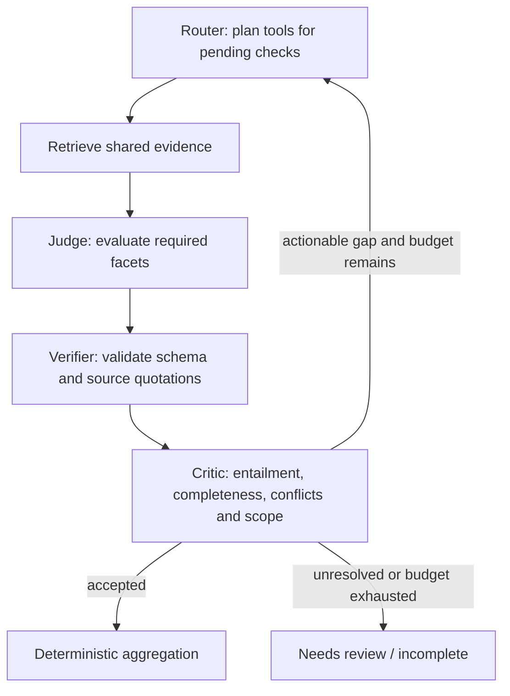

# Contract Analyzer design

## Scope

The existing Streamlit UI, history, chat, KPI dashboard and MCP shell are retained.
The core is an in-place replacement: a question-independent document layer and a
bounded LangGraph evidence loop. Historical design/task/review documents describe
earlier implementations; this document is the current design.

The fixed assignment rubric contains 25 checks grouped 7/4/4/5/5. Each check has
explicit required facets and interpretive guidance, but no contract section or
control IDs. Recommendations, alternatives and conditional language are preserved.
The rubric is not rewritten to fit an uploaded document.

## Document foundation

`core/ingest/parse.py` uses PDF layout coordinates to retain prose blocks and
table rows, cells and headers. Ruled tables are detected geometrically;
borderless table recognition is conservative and heuristic. `chunk.py` assigns
document-derived sections/appendices, parent relationships and optional IDs.
An ID is never required to retain or retrieve a row. Sections are not restricted
to the sample's numbers and exhibits are not restricted to A-H.
Risk row IDs carry their document-derived exhibit as `risk:<exhibit>:<id>`.
Without an exhibit, identified risk rows use `p<page>:risk:<id>` and citations
fall back to the page; other identified rows use `p<page>:requirement:<id>`
instead of inventing an exhibit. Only short, standalone heading-like blocks
start exhibit scope, not paragraphs opening with an inline appendix reference.
PDF extraction keeps these headings separate from following prose.
Numbered body sections clear exhibit scope. Section metadata takes precedence
over stale exhibit metadata in historical snapshots. Historical results prefer
saved source metadata; ID-only citations omit trailing `:partN` split markers,
and legacy IDs lacking location metadata are not assigned an invented exhibit.

Long blocks are split into bounded contiguous slices. Context reads restore the
parent clause or table. Repeated table headers can link adjacent-page fragments.
Page/bounding-box metadata remains on each physical fragment. Retrieval-enriched
text includes headings/headers; quotations must match source text, not enrichment.
Whitespace normalization is allowed, but verification does not erase word boundaries.
Cross-reference keywords are case-insensitive; labels match uppercase letters and
digits (including dotted section numbers), not lowercase prose after a keyword.

This release supports text-extractable PDFs. Image-only pages and embedded images
requiring interpretation are explicit review conditions; there is no OCR/VLM
fallback pretending to have read them. Complex multi-column/merged-cell layouts
remain a limitation, not a claimed universal parsing capability.
Embedded images and uncertain reading order still emit page-specific warnings,
but do not mark otherwise readable pages unreadable. Pages without extracted
blocks, or with images and fewer than 40 text characters, remain unreadable.

Indexes are keyed by structural representation/version and embedder identity.
Real lexical/vector retrieval is fused; an unavailable embedding backend is an
explicitly reported lexical-only degradation, never a silent fake-vector fallback.
`FakeEmbedder` is for tests only.

## LangGraph orchestration

`core/agents/graph.py` compiles a typed `StateGraph` for each question:

Agent state contains pending checks, evidence packs, findings, validation results,
targeted feedback, round number, stop reason and audit events. Communication uses
validated JSON and typed Python records, not free-form inter-agent messages.

- Router selects among the same evidence tools exposed to chat/MCP: search,
  context/table reads, actual-reference resolution and modifier discovery.
- The first pass requires semantic retrieval. Source lookups are only based on
  identifiers discovered in the current document.
- Structured evidence-tool errors contribute no chunks and do not abort other
  checks. Current-pass errors stay in each affected evidence pack and judge/critic
  feedback; the router can select an alternative within the existing follow-up
  budget. A successful follow-up clears current-pass errors, not their audit
  history. Failed modifier scans are reported as incomplete and retried, not
  cached as empty successes. Registry numeric bounds reject invalid arguments
  before handlers run.
- A document-wide modifier candidate scan complements positive-query retrieval.
  Candidates are not automatic downgrades; the judge/critic must establish
  normative authority, relevance, scope, dates and the specific affected obligation.
- Judge assesses every required facet and may use multiple supporting, contrary
  or conditional quotations. A grouped check cannot pass from one covered facet.
- Mechanical verification cannot be overruled by a semantic critic. NOT_FOUND
  may legitimately have no quotation; invalid output is not absence of obligation.
- Critic either accepts, requests a specific follow-up, or reports unresolved
  evidence. Initial NOT_FOUND requires an alternate-search pass.
- Repeated identical actions stop; novel searches may return unchanged evidence
  and still allow a justified absence finding after critic review.
- Early stops retain already verified MET/PARTIAL/CONTRADICTED/NOT_FOUND findings,
  including confidence, with incomplete search and the stop reason appended to
  gaps. Unverified or unassessed checks remain UNRESOLVED (ERROR on backend failure).
  Unreadable/truncated coverage still flags all affected packs without page scoping,
  but uses the same finalization rather than erasing verified findings.

Defaults per question: two follow-up rounds, 200 tool calls, 32 LLM calls,
120,000 cumulative tokens, 1,800 seconds, and 48,000 source characters per check.
`CA_ANALYSIS_QUESTION_TIMEOUT_S` configures the per-question time budget, including
quota waits. The transport permits up to 12 retries and shares a server-mandated
cooldown across calls on the same client. It honors Retry-After (seconds or HTTP
date), then exhausted-quota reset headers, otherwise a 60-second exponential
rate-limit backoff capped at 600 seconds. Each HTTP operation also has a finite
1,800-second retry budget; the earlier graph/request deadline wins.
UI countdowns and MCP polling expose waits; `backend:wait` spans retain their
reason and duration in local logs and Langfuse. Cooldowns and active graph state
are in-memory, not durable cross-process pause/resume.
The HTTP model client additionally preflights complete prompts against
`CA_LLM_MAX_INPUT_TOKENS` (5,500 by default) before dispatch. GPT-OSS uses its
Harmony tokenizer; unrecognized model families use an explicitly approximate
o200k tokenizer, with a framing allowance. Setup caches tokenizer data locally.
This request-size limit is not a throughput guarantee for provider TPM quotas.
Automatic parent reads use bounded neighboring sources and table headers; broad
references are query-ranked rather than adding an entire appendix to each check.
The full-table tool remains available. Critic requests split by check when needed;
no evidence is silently clipped to make an over-budget request appear complete.
Prompt preflight estimates are conservative, not tokenizer-exact. Transport
timeouts and Retry-After waits honor the remaining graph deadline. Invalid judge
JSON gets one bounded repair attempt; exhausted failures remain review outcomes.
Large/truncated evidence packs are not accepted as complete analyses.

## Decision semantics

Internal check states are MET, PARTIAL, CONTRADICTED, NOT_FOUND, UNRESOLVED or
ERROR. Aggregate only verified findings:

- All applicable mandatory facets met: Fully Compliant.
- Some facets supported and others not satisfied: Partially Compliant.
- No mandatory facets supported after adequate retrieval: Non-Compliant.
- With at least one resolved check, UNRESOLVED checks count as not satisfied,
  lower confidence via the minimum rule and remain named in the rationale.
- Any ERROR, or no resolved checks: Indeterminate.
- Unresolved checks or unfinished search retain the outer incomplete status,
  even when a question has a three-state answer.

The public `questions` array contains classified three-state objects, including
questions with unresolved checks or unfinished search.
`review_required` identifies unclassified questions; `check_results` preserves the
25-check evidence matrix. The internal historical `Indeterminate` state is not
exported as a fourth assignment compliance state.

Risk acceptance is neither remediation nor automatically a waiver. A shared
control ID does not justify downgrading unrelated checks. Evaluate the source's
actual terms at the persisted assessment date (UTC run date by default, caller
override allowed). Synthetic regression tests pin an explicit date.

Confidence is a documented heuristic: the minimum of verified judge and critic
confidence, then the weakest check at question level. It is not claimed to be
statistically calibrated. Measured calibration requires independently labeled
evaluation results.

## Audit, persistence and privacy

Every graph node and tool call has local JSON/OTel spans. Audit records preserve
node order, trace/span IDs, question/round, timing, model usage, source IDs,
tool/query identity, structured action reasons, follow-up objectives and stop/error
conditions. They do not expose hidden model chain-of-thought.

SQLite `run_snapshots` stores versioned result/evidence/usage snapshots;
`audit_events` stores ordered node records when the run is saved. Both are additive
tables, preserving legacy runs. New historical results and optional judge scoring
use saved evidence instead of silently re-running retrieval with today's parser.
The audit is application-level traceability, not a tamper-proof compliance archive.
JSON logs are live; SQLite snapshots are committed at run completion. This version
does not claim crash-resumable LangGraph checkpointing.

LangSmith hosted tracing is explicitly disabled for graph evidence. OTel is
optional, and enabled automatically when local Langfuse is configured. A single
native span tree feeds stderr, rotating local OTel JSONL and Langfuse OTLP.
Model calls have explicit generation spans; parent-node usage stays metadata
to avoid double-counting. The Monitoring UI links to Langfuse and run traces.
The exporter runs asynchronously; local audit does not depend on its availability.
Only loopback export endpoints are accepted. Confidential PDFs, derived evidence, logs and
databases must stay local. Remote inference/embeddings require explicit
`allow_remote=True` for non-confidential material; the UI consent is scoped to
the uploaded document. The assignment and sample must use local providers.

## KPI semantics

Operational KPIs: P50/P95 latency, node durations, LLM/tool calls, token usage,
estimated LLM plus embedding API costs, completion/review rates, quote-verification
attempt failures, follow-up resolution yield and budget exhaustion.

Latency P50/P95 and the seven-day cost median use the same linear interpolation
between sorted observations at `pct * (n - 1)` (empty inputs return zero).
Model pricing prefers exact keys, then the longest unqualified substring match,
so dated model IDs inherit their most specific base model's rates.

Quote validation measures provenance, not semantic faithfulness. NOT_FOUND and
compliance distributions are diagnostics/business outcomes, not model accuracy.
A short document, absence of tables, or absence of modifiers is not a failure.
New telemetry excludes legacy runs lacking the required denominators.
Unavailable metrics remain unavailable rather than showing fabricated accuracy.

Optional RAGAS scores are explicitly labeled LLM-judged. Faithfulness can use the
persisted evidence without a reference label; reference-based metrics need reviewed
gold labels for the matching document/rubric version. Never derive an "exact
faithfulness" value from string matching. Dashboard renders do not trigger paid
judge calls. Partial/failed judge passes are not cached as complete scores.

Alerts are provisional engineering thresholds, not measured service-level
objectives: quote failures warn/page at 5%/15%, review rate warns above 20%, budget
exhaustion above 10%, and follow-up yield below 25% (last three after five instrumented
runs). Inspect workload mix, sources and traces before changing models or budgets.

## Evaluation

The sample is one local regression fixture, not the retrieval specification or a
labeled ground-truth dataset. Historical `eval/gold*.yaml` labels must be reviewed
before claiming accuracy under the new semantics. The deterministic client tests
orchestration only and no longer writes synthetic accuracy/calibration rows.

`tests/test_agent_graph.py` covers independent unnumbered/renumbered prose,
non-ID PDF tables, parent/context provenance, word-boundary quote fabrication,
bounded follow-up, unreadable input and audit round trips.

`python -m eval.live_e2e --output-dir PATH` explicitly uses the configured API on
independently authored, non-confidential supply-contract questions and fixtures:
25 checks plus a missing-obligation/renumbered variant. It tests schema, source
verification, decisions, SQLite round trip, audit, KPI and registry integration.
It is not a claim of accuracy on confidential compliance documents. Reports name
the actual model; `--model` can override the model without changing `.env`.
